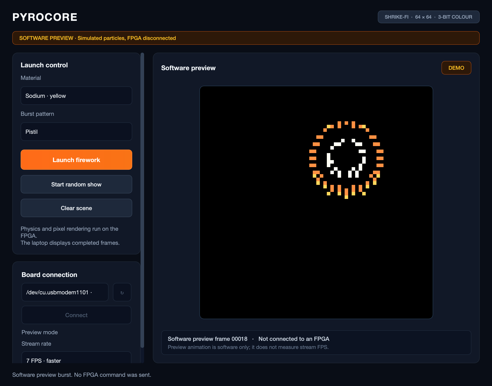

# PyroCore

A small FPGA fireworks engine for the **Vicharak Shrike-Fi**. The FPGA calculates
particle motion and renders a 64 × 64 image in eight colours. The ESP32 carries
commands and frames; the desktop app provides controls and displays the result.



*The desktop app waiting for a board connection. Fireworks appear from received
FPGA frames after connecting.*

## What it does

- Eight particles with fixed-point motion, gravity, lifetime and short trails.
- Glitter on every material and pattern, with each spark retaining its colour.
- Radial, Ring, Willow and dual-colour Pistil patterns; six material presets.
- Two 64 × 64 × 3-bit framebuffers in dedicated FPGA BRAM.
- Launch, Clear and Random Show controls, with validated frame reception.
- A 30 FPS desktop target with 18/7/5 FPS fallbacks for flexibility.

The included design targets **SLG47910V Rev BB + ESP32-S3 with 8 MB flash** on
Shrike-Fi. Other boards need a port; the included binary is device- and board-specific.

## Setup

You need the matching Shrike-Fi board, a USB data cable, Git and Python **3.9–3.13**.
Connect to the board's **native ESP32 USB** port. No external display or extra
wiring is required, and the included FPGA image needs no FPGA compiler.
Current board and desktop checks used macOS; Windows/Linux host workflows have
not had the same physical-board validation.

### Install the desktop app

macOS or Linux:

```sh
git clone https://github.com/ANKITRA-J/pyrocore.git
cd pyrocore
python3 -m venv .venv
.venv/bin/python -m pip install -r desktop/requirements.txt
```

<details>
<summary>Windows PowerShell</summary>

Using an installed Python 3.13, or another supported version:

```powershell
git clone https://github.com/ANKITRA-J/pyrocore.git
cd pyrocore
py -3.13 -m venv .venv
.\.venv\Scripts\python.exe -m pip install -r desktop/requirements.txt
```

</details>

No environment activation is required. On Windows, replace `.venv/bin/python`
in the remaining commands with `.\.venv\Scripts\python.exe`.

### Load the board package

Connect the board to its **native ESP32 USB** port and find its serial port.
Typical ports are `/dev/cu.usbmodem…` on macOS, `/dev/ttyACM…` on Linux and
`COM…` on Windows. Close PyroCore and other serial clients. Replace `YOUR_PORT`
below.

#### Option A — prebuilt release (recommended, no Arduino toolchain)

`release/v0.4.0/` contains the application, bootloader, partition table and
FPGA filesystem, already built and checksummed. This path needs Python and
esptool only — not the ESP32 Arduino core.

```sh
.venv/bin/python -m pip install -r tools/requirements-flash.txt
.venv/bin/python tools/flash_release.py --port YOUR_PORT
```

If Arduino's ESP32 core is already installed, the helper finds its bundled
esptool and the first line is unnecessary. It verifies `SHA256SUMS`, writes all
five sections and checks the flash hashes; the upload takes about 15 seconds.
This replaces the existing application and filesystem. See
[the release notes](release/v0.4.0/FLASHING.md) for the raw esptool equivalent.

#### Option B — build from source with Arduino

Install [Arduino CLI](https://docs.arduino.cc/arduino-cli/installation) and make
`arduino-cli` available in your terminal. Install the pinned dependencies:

```sh
arduino-cli core update-index --additional-urls https://espressif.github.io/arduino-esp32/package_esp32_index.json
arduino-cli core install esp32:esp32@3.3.12 --additional-urls https://espressif.github.io/arduino-esp32/package_esp32_index.json
arduino-cli lib update-index
arduino-cli lib install ArduinoJson@6.21.5
```

Then upload the application and FPGA image together:

```sh
.venv/bin/python tools/build_firmware.py --bitstream firmware/pyrocore/data/fpga_bitstream.bin --port YOUR_PORT
```

This uploads **both the ESP32 application and the FPGA image**, replacing the
existing application/filesystem. Back up any existing board contents you need.
The helper selects the board's USB CDC and 8 MB flash settings automatically.
The FPGA is configured at boot; this workflow does not program OTP.
Without `--port`, the helper only builds. Arduino IDE's ordinary Upload button
does not install the FPGA image into LittleFS, so use the complete helper package.

### Connect and launch

Run from the repository root:

```sh
.venv/bin/python desktop/app.py
```

1. Select the native USB port and click **Connect**.
2. Confirm bridge **v0.4.0** and wait for **LIVE FPGA** with received frames.
3. Choose **Sodium · yellow** and **Pistil**, then click **Launch firework** for
   a yellow outer group and smaller white glittering core.
4. Try other selections or **Start random show**. Use **Clear scene** to clear
   the image; **18 FPS**, **7 FPS** and **5 FPS** select slower stream targets.

The app displays received FPGA frames. Idle black frames with a healthy FPS are
normal; stale or disconnected streams retain the last image with an explicit
status. Every spark glitters, including its trail; motion continues while a spark
is hidden. Willow gets a slightly longer Random Show interval for its falling arc. 
Choose a non-white material to see Pistil's white-core contrast. Scroll the sidebar 
in a short window. On macOS, `Launch PyroCore.command` is also available after 
installing the app.

For later updates, run `git pull --ff-only`, close the old app and reopen it.
This release (v0.4.0) changes board communication to 30 FPS with 625000 baud FPGA link, 
so upgrading from v0.3.0 or earlier requires uploading the matching **v0.4.0 application 
and FPGA image together** using [the helper above](#load-the-board-package). Updating 
only the desktop app does not enable the faster board link. The 30 FPS target achieves 
approximately 29.4 FPS on hardware with the 40 Hz render scheduler.

<details>
<summary>Troubleshooting</summary>

| Symptom | Check |
|---|---|
| No board port | Use a data cable and native USB, then refresh. On Linux, check serial-port permissions. |
| Port busy or upload fails | Close other serial clients and recheck the port/cable. Upload baud defaults to 115200. |
| FPGA image unavailable or no valid frames | Use the matching board and complete helper package, including LittleFS; check the status/error text. |
| Black image with healthy FPS | Press Launch; particles expire and Clear deliberately produces black frames. |
| No Pistil option | Update the repository and restart the app. |
| Pattern 3 rejected or incorrect | Upload the matching v0.4.0 application and FPGA image together. |
| Stream rate unstable | Select 7 FPS or 5 FPS and check the status/error counters. |
| Pistil has no colour contrast | Choose a non-white material; Aluminium makes both groups white. |
| Controls below the window | Scroll the sidebar or enlarge the window. |
| Dependency installation fails | Use Python 3.9–3.13 and install into `.venv`. |

</details>

## Status

Firmware v0.4.0 implements 30 FPS with 625000 baud FPGA UART (5 clocks/bit) and
40 Hz render scheduler. Physical validation passed with 29.436 FPS measured performance.
Desktop updated to support 30/18/7/5 FPS stream targets with improved Random Show timing.
Zero communication errors during testing. Ready for demonstration.

For source changes, builds and technical references, see [Development](docs/DEVELOPMENT.md).
Source attribution and bundled notices are listed in [Credits](docs/CREDITS.md).
