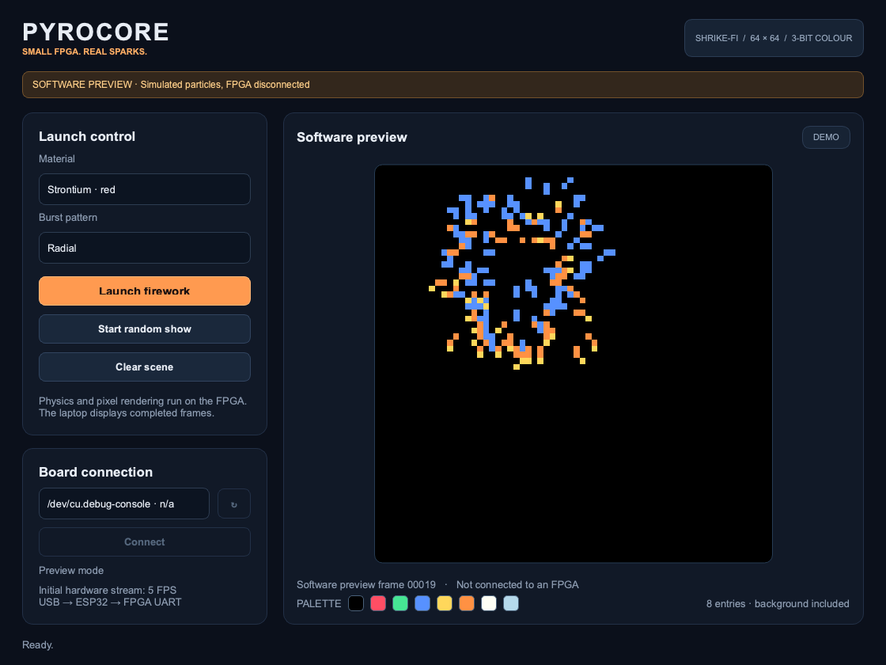

# PyroCore

FPGA-generated pixel fireworks on the Vicharak Shrike-Fi. The FPGA owns particle
motion and every image pixel; ESP32 carries commands/frames and the laptop displays
the FPGA's completed64×64image through a configurable eight-entry palette.

**Development checkpoint:** the first integrated build is implemented and passes
FPGA compilation/routing, firmware compilation, and complete UART-frame simulation
through the firmware and desktop decoders. No PyroCore firmware has been uploaded
to a physical board yet.
Read **[docs/HANDOFF.md](docs/HANDOFF.md)** for the latest verified state and next task.

## Included

- Eight-particle fixed-point FPGA physics: gravity, lifetime, clipping, radial/ring/willow.
- Six visual material presets; white glitter uses FPGA pseudorandom flicker.
- Two64×64×3bit framebuffers in six dedicated BRAM slices with safe frame ownership.
- Binary CRC8-protected UART frames and an ESP32 USB bridge that forwards validated images.
- Native desktop controls: Launch, Clear, Random Show, live status and received frame rate.
- A clearly labelled **software preview** for looking at the UI without connecting hardware.
- Reproducible build commands and implementation notes for continuation in another IDE.

The initial hardware transport targets about5FPS. Smooth20–30FPS needs a later
measured faster-link change. The preview animation does not measure FPGA performance.



*Offline software preview of the interface. This image is not physical FPGA output.*

## Desktop

Python3.9–3.13:

```sh
python3 -m venv .venv
.venv/bin/python -m pip install -r desktop/requirements.txt
.venv/bin/python desktop/app.py --demo
```

On this Mac, the project environment is already installed. `Launch PyroCore.command`
opens the normal control panel. For the board, launch without `--demo`, select its
native USB port and connect.
See [desktop instructions](docs/DESKTOP.md) for Windows and troubleshooting.

## FPGA and firmware

Install Renesas Go Configure Software Hub with SLG47910 RevBB support.
The build helper uses the bundled Yosys v59 and eda-placer v23.

```sh
python3 tools/build_fpga.py all --cpus 4
python3 tools/build_firmware.py --bitstream build/fpga/FPGA_bitstream_MCU.bin
```

A compiled FPGA image is also included at
`firmware/pyrocore/data/fpga_bitstream.bin`. To build the firmware with that
checkpoint without rerunning the FPGA compiler:

```sh
python3 tools/build_firmware.py --bitstream firmware/pyrocore/data/fpga_bitstream.bin
```

These commands compile and package files only. Firmware uses ESP32 Arduino core
3.3.12 and ArduinoJson6.21.5. See [firmware instructions](docs/FIRMWARE.md).
An explicit `--port` is required for an upload; that replaces the board application
and filesystem. No OTP programming is part of this workflow.

To inspect the FPGA in the vendor GUI, open `fpga/project/pyrocore.ffpga` after
`python3 tools/build_fpga.py prepare`. Source of truth is `fpga/rtl`; the combined
`ffpga/src/main.v` is generated for the GUI.

## Checkpoints and continuation

```sh
git pull --ff-only
git log --oneline -5
```

Read these before continuing:

1. [HANDOFF.md](docs/HANDOFF.md): verified results, current limitations, exact next step.
2. [PROTOCOL.md](docs/PROTOCOL.md): shared frame format and command contract.
3. [PROJECT_PLAN.md](docs/PROJECT_PLAN.md): background and intended scope; the handoff
   takes precedence for current implementation status.

Run host checks with `python3 tools/check_host.py`. After RTL simulation, use
`python3 tools/check_host.py --packet build/sim/frame_packet.bin` to pass the
FPGA-produced packet through the exact firmware parser and desktop decoder.
Run RTL simulations with `python3 tools/run_rtl.py`; minimal vendor Verilator
installations also need `--runtime` pointing to matching5.034 runtime sources.
Keep routine changes in useful commits and update the handoff before switching IDEs.

## Credits

Project authorship, reused source, hardware/tool acknowledgements and the retained
upstream license notice are recorded in [CREDITS.md](docs/CREDITS.md).
